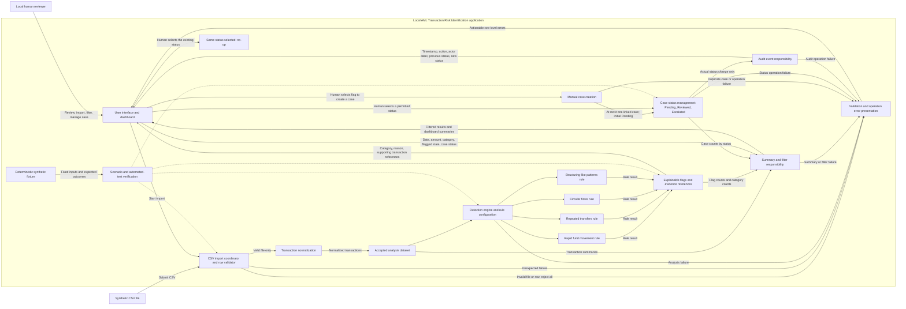

# Logical Architecture

**Project:** AML Transaction Risk Identification System
**Version:** 0.1
**Status:** Approved
**Approval gate:** Human architecture review required before Technical
Architecture work begins
**Sources:** Approved `docs/requirements/BRD.md` (Version 0.2),
`docs/requirements/PRD.md` (Version 0.1),
`docs/requirements/FRD.md` (Version 0.1), and
`docs/requirements/NFR.md` (Version 0.1)

> This is a logical design of responsibilities and flows, not a claim that
> these components are implemented. It does not select frameworks, languages,
> storage, hosting, or infrastructure.

## Goals and constraints

Describe a beginner-friendly logical structure for the four-day, local,
educational MVP. The design supports one local human reviewer and synthetic
transaction data only. It supports all four configurable pattern categories,
reviewable flags, and human-managed cases without making a risk determination
or decision on the user's behalf.

Constraints inherited from approved requirements:

- CSV is the MVP input. Validate the complete file; if any row is invalid,
  reject the entire import, report actionable row-level errors, and retain no
  transactions from that import.
- All four detection categories are in scope: rapid fund movement, repeated
  transfers, circular flows, and structuring-like patterns.
- Flags show category, understandable reason, and supporting transaction
  references. No numeric risk score or probability is presented.
- A flag is an indicator for human review, not proof of money laundering.
  No autonomous accusation or automated financial or law-enforcement
  decision is in scope.
- A human explicitly creates at most one case per flag. A new case starts
  Pending; only Pending, Reviewed, and Escalated are permitted. All
  transitions between distinct statuses are allowed, including returning to
  Pending to reopen a case.
- The design remains local and single-user. It does not imply authentication,
  multiple roles, production deployment, regulatory compliance, or
  institution integrations.
- Thresholds, CSV contract details, input capacity, performance targets,
  persistence, and other documented open decisions remain unresolved.

## System context

The system boundary is the local educational application and its synthetic
inputs. A local human reviewer supplies a CSV, reviews summaries and flags,
and chooses whether to create or update a case. No external financial
institution, identity, screening, or decision service participates in the
logical flow.

The application separates user interaction, import acceptance, analysis,
presentation, case handling, and audit responsibilities. Those boundaries
describe logical responsibilities only; they do not prescribe separate
processes, services, or deployment units.
## Logical components and responsibilities

The diagram shows logical responsibilities and exchanges, not deployment
topology. The import coordinator sends data onward only after complete
validation; an invalid file takes the rejection/error path and does not enter
the accepted dataset. The detection engine evaluates each configured rule
category against that dataset. Results become explainable flags that refer
to supporting transactions and feed both flag review and dashboard summaries.
Filters affect displayed results. A human action, not rule detection, starts
case creation. Actual status changes produce the specified audit details;
selecting the existing status is a no-op and produces no status-change event.

| Logical component | Responsibility and boundary | BRD traceability | PRD traceability | FRD traceability | NFR traceability |
|---|---|---|---|---|---|
| User interface and dashboard | Presents import controls and outcomes, transaction and flag review, case views, and errors. Shows accepted transaction count, total flags, flags by rule category, and cases by status. Exposes approved filters on applicable views and distinguishes empty data, no matches, and failures. | FR-004, FR-009–FR-014, FR-017; NFR-009 | Journeys A–C; Sections 5–6 | FRD-004–FRD-006, FRD-016–FRD-020 | NFR-001, NFR-004, NFR-009, NFR-013 |
| CSV import coordinator and row validator | Receives CSV submissions, validates file structure and every row against the approved CSV contract, collects actionable errors, and makes a whole-file accept/reject decision. It passes no records from an invalid import into analysis. It does not define file capacity or technical error formats. | FR-001–FR-003; NFR-003, NFR-007 | Journey A; Import behavior | FRD-001–FRD-004 | NFR-003, NFR-007, NFR-014, NFR-015 |
| Transaction normalization and analysis-dataset boundary | Converts accepted rows into a consistent logical transaction representation for rule evaluation, summaries, filters, and evidence references. It preserves relationships between references and accepted records. It does not decide whether separate valid imports are combined or selected. | FR-001–FR-002, FR-004, FR-015 | Sections 4–6 | FRD-001, FRD-005–FRD-010, FRD-019 | NFR-002–NFR-003, NFR-005 |
| Detection engine and rule configuration | Coordinates four separately understandable rule responsibilities: rapid fund movement, repeated transfers, circular flows, and structuring-like patterns. Uses approved configurable parameters and emits rule matches with context for explanations. Exact thresholds, windows, matching logic, and boundary behavior remain open. | FR-005–FR-008, FR-018; NFR-006 | Sections 2, 4–6; Risk indicators | FRD-007–FRD-010, FRD-019 | NFR-006, NFR-012 |
| Explainable flags and evidence | Represents each rule match as a flag with category, understandable reason, and supporting transaction references. Links evidence to accepted records. Does not assign a numeric score/probability or state that a person or transaction is culpable. | FR-009; NFR-004, NFR-011–NFR-012 | Risk indicators; Safe interpretation | FRD-007–FRD-012 | NFR-004, NFR-011–NFR-012 |
| Summary and filter responsibility | Derives dashboard measures and returns view-specific results after applicable filters are combined using AND and inclusive ranges. Applies case-status filtering only to items linked to a case; unlinked transactions/flags are excluded while that filter is active. It does not choose multiple-import scope. | FR-004, FR-010, FR-014; NFR-009 | Journey B; Dashboard and review | FRD-005–FRD-006, FRD-016–FRD-018 | NFR-009, NFR-015 |
| Case management | Creates a case only on explicit human action from a flag, enforces at most one linked case per flag, and sets initial status to Pending. Allows exactly Pending, Reviewed, and Escalated, with transitions Pending→Reviewed, Pending→Escalated, Reviewed→Pending, Reviewed→Escalated, Escalated→Pending, and Escalated→Reviewed. Same-status selection is a no-op. | FR-011–FR-012; NFR-008 | Journey C; Case and audit behavior | FRD-013–FRD-015 | NFR-008, NFR-016 |
| Audit event responsibility | For actions selected for audit, records timestamp, action, and actor label. For actual case-status changes, also records previous and new status. Does not prescribe persistence, retention, or actor identity/authentication. | FR-013; NFR-008 | Journey C; Auditability | FRD-014–FRD-015 | NFR-008, NFR-016 |
| Error handling and outcome presentation | Converts validation and operation failures into clear user-visible outcomes without false success. Separates invalid-file rejection, no-data and no-results states, and unexpected operation failures. Technical error codes/formats remain out of scope here. | FR-003; NFR-007 | Import behavior; Case and audit behavior | FRD-002–FRD-004, FRD-016–FRD-018 | NFR-003, NFR-007, NFR-015 |
| Synthetic scenario and verification responsibility | Supplies fixed synthetic inputs and expected outcomes for all four rules, benign lookalikes, negative examples, rule boundaries, and invalid CSV cases. Supports repeatable verification of imports, flags, cases, and audit behavior without representing outcomes as real-world accuracy. | FR-015–FR-016; NFR-005–NFR-006, NFR-012 | Sections 4 and 6 | FRD-019 | NFR-005, NFR-006, NFR-012 |

These are logical boundaries. Whether responsibilities are combined or
separated in implementation is a Technical Architecture decision after
repository inspection.

## Key user and data flows

### Valid CSV import and analysis

1. The local reviewer submits a synthetic CSV through the interface.
2. The import coordinator checks file structure and all rows against the
   approved CSV contract.
3. If every row is valid, the coordinator passes the records to normalization
   and then to the accepted analysis-dataset boundary.
4. The dataset is the common logical input for all four rules, dashboard
   measures, filters, and evidence references.
5. Detection results are converted into flags; dashboard and review views
   present summaries and supporting evidence.
6. No conclusion beyond configured rule matches is made.

### Invalid CSV

1. The validator collects file-level and actionable row-level errors.
2. If any row is invalid, the import is rejected as a whole.
3. No transaction from that import is passed to normalization or left
   partially accepted; previously accepted data is not represented as part of
   the rejected import.
4. The interface reports rejection and errors without a success-shaped
   result.

### Flag review, case, and audit

1. The human opens a flag and inspects its category, explanation, and
   supporting transaction references.
2. The human chooses whether to create a case. Detection never creates one
   automatically; a second case for the same flag is prevented.
3. A new case starts Pending. The human may choose any distinct status
   transition among Pending, Reviewed, and Escalated, including returning to
   Pending to reopen it.
4. An actual status change yields an audit event with timestamp, action,
   actor label, previous status, and new status. Selecting the existing status
   does not create a status-change event.

### Dashboard filters

The summary/filter responsibility computes the approved dashboard measures
for the currently available analysis dataset and returns view-specific
filtered items. Applicable filter criteria combine using AND; ranges are
inclusive. Case-status filtering applies only to cases and to transactions or
flags linked to those cases. The exact dataset when there are multiple valid
imports remains unresolved.

### Deterministic verification

The logical verification responsibility runs the same versioned synthetic
fixture against the import, rule, evidence, case, and audit boundaries. It
compares observed results with documented expectations. Threshold-dependent
boundary expectations are not finalized until rule configuration and
comparison conventions are approved.

## Trust boundaries and human decision points

- **CSV input boundary:** Imported content is untrusted data even though the
  MVP fixtures are synthetic. The import path validates it, rejects
  unsupported formats, and treats cell contents as data rather than commands,
  scripts, or formulas. CSV contract and capacity limits are open.
- **Local user boundary:** The MVP serves one local user and does not provide
  authentication or multi-user roles. This is a scope boundary, not a claim
  that a production access-control model exists.
- **Analysis/result boundary:** The engine reports only rule matches based on
  available data and approved configuration. Flags remain indicators for
  human review, not proof of money laundering.
- **Human decision points:** A human decides whether to create a case and
  manages case status. No automated accusation, law-enforcement conclusion,
  account freeze, transaction block, or other financial decision is produced.
- **Audit boundary:** Audit events contain only the specified fields.
  Actor-label representation, additional audited actions, persistence, and
  retention remain unresolved.
- **External systems:** No real financial institution or production
  integration is included. No external service is assumed by this logical
  design.

## Quality attributes and trade-offs

- **Data integrity over partial import availability:** Whole-file validation
  and atomic rejection mean one invalid row prevents all records in that
  import from becoming available. This favors predictable imports over
  accepting a valid subset.
- **Explainability over opaque scoring:** Rule categories, reasons, and
  evidence references are preserved. No numeric risk score or probability is
  introduced.
- **Repeatability over realism claims:** A fixed synthetic fixture enables
  consistent demonstrations and tests, but says nothing about real-world
  detection accuracy.
- **Local simplicity over production controls:** Single-user local scope
  keeps the MVP small. Authentication, multi-user controls, production
  operations, and integrations are not implied.
- **Performance remains uncommitted:** No workload, environment, response
  time, throughput, or resource target is selected. CSV maximum size/row
  limits and oversized-input behavior are also unresolved.
- **Maintainability:** Separate logical responsibilities make validation,
  rules, evidence, cases, and audit behavior independently reviewable, while
  leaving implementation grouping to the later technical stage.
- **Accessibility:** The approved NFR includes keyboard operation, visible
  focus, and accessible labels as requirements. This design does not imply
  that accessibility has already been implemented or verified.

## Alternatives considered

- **Partial import:** Rejected for the MVP because approved behavior
  requires whole-file rejection when any row is invalid. Partial acceptance
  would make analysis scope and dashboard counts less predictable.
- **Opaque model or numeric score as the primary result:** Not selected.
  Approved behavior requires explainable rule categories, reasons, and
  evidence, and excludes numeric risk scores.
- **Automatic case creation for every flag:** Not selected. Case creation is
  a human decision and is limited to one linked case per flag.
- **Distributed or externally integrated components:** Not assumed. The
  local educational scope does not require external services; technology and
  deployment decisions belong to the later technical stage.
- **One undifferentiated detection rule:** Not selected as a logical model.
  The four rules have distinct behavior and scenario traceability. Whether
  implementation combines or separately organizes them remains a technical
  design decision.

## Open decisions

- **Detection:** Exact thresholds, time windows, matching logic, required
  inputs, parameter presentation, and boundary comparison conventions for
  each rule remain open. This architecture does not set them.
- **CSV contract:** Required/optional columns, timestamp/time-zone
  interpretation, amount/currency semantics, duplicate-ID policy, and
  detailed validation/error formats remain open.
- **CSV capacity:** Maximum file size, maximum row count, and expected
  oversized-file behavior remain open; no unlimited-capacity assumption is
  made.
- **Analysis dataset:** Whether multiple accepted imports are combined or a
  single import is selected for summaries and detection remains open.
- **Dashboard and filtering:** The FRD defines measures and filter
  combinations; result ordering and exact empty-state wording remain open.
- **Cases and audit:** Actor-label representation, which non-status actions
  are audited, audit persistence, retention, and recovery/deletion behavior
  remain open.
- **Scenario fixture:** The fixture must be deterministic and cover the
  required scenarios, but the final record values and threshold-boundary
  expected outcomes depend on the approved CSV contract and rule definitions.
- **Error presentation:** Row-level errors are required, but exact validation
  and operational error formats remain for later contract/design work.
- **Quality targets:** Representative performance workload, local test
  environment, response-time/resource targets, and detailed test coverage
  targets remain open.
- **Technology and deployment:** Languages, frameworks, persistence
  technology, packaging, and local execution mechanism belong to Technical
  Architecture and are intentionally not selected here.
- **Source-record note:** The approved NFR contains a note that BRD/PRD
  headers still say Draft, although their current headers and approval
  sections now say Approved. This is a stale note in the read-only NFR; it
  does not change the approval records used for this stage.

## Human approval

- [x] Confirm the diagram and logical component responsibilities reflect the
      approved BRD, PRD, FRD, and NFR without choosing implementation
      technology.
- [x] Confirm CSV rejection, normalized accepted-data flow, four detection
      categories, explainable flags, and human-review safeguards.
- [x] Confirm dashboard summaries and filters match the approved FRD.
- [x] Confirm manual one-case-per-flag behavior, case statuses/transitions,
      and audit fields.
- [x] Review the assumptions and open decisions, including multiple-import
      scope, thresholds, CSV contract/capacity, performance, and audit
      persistence/retention.
- [x] Confirm that no production readiness, regulatory compliance, or
      real-world effectiveness claim is made.

**Status:** Approved.
**Reviewer:** Rakesh.
**Decision and date:** Approved as the Version 0.1 baseline for the next SDLC stage, 2026-10-20.
**Requested changes:** None.

This approval is the human reviewer's decision; Copilot's automated checks do
not constitute approval. Do not begin Technical Architecture until explicitly
requested by the human reviewer.
