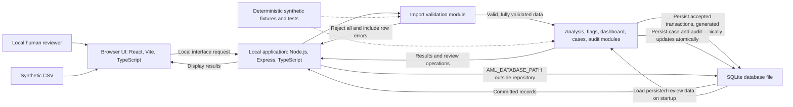

# Technical Architecture

**Project:** AML Transaction Risk Identification System
**Version:** 0.1
**Status:** Approved
**Approval gate:** Approved Technical Architecture baseline. Data Model / API
Contract / User Stories is the next SDLC stage and has not begun.
**Sources:** Approved BRD, PRD, FRD, NFR, Logical Architecture, repository
inspection, and the draft `docs/design/design-doc.md`

> The technology and persistence decisions below were confirmed by the human
> reviewer for this architecture. They describe the approved direction, not
> implemented or repository-verified behavior. The specific SQLite driver and
> several product requirements remain open.

## Verified repository baseline

Repository inspection on 2026-10-20 found:

- The repository contains project documentation, Copilot instructions,
  agents, and skills. It has no application source tree.
- No package manifest, dependency lockfile, build configuration, database
  schema, migration, test configuration, or application entry point is
  present.
- Consequently, no application build, test, or run command, dependency,
  framework, API, persistence behavior, or runtime topology can be verified.
- `docs/architecture/technical-architecture.md` was the existing
  Not-started scaffold and is the only document populated in this stage.
- The approved BRD, PRD, FRD, NFR, and Logical Architecture establish product
  behavior and boundaries, not a technology stack.

The BRD and PRD are marked Approved in their documents. The FRD records
human approval. The NFR records product-owner and technical-reviewer
approval. The Logical Architecture is marked Approved and records human
approval for Version 0.1. These documents remain unchanged.

`docs/design/design-doc.md` is a draft, not an implementation record. The
human has separately confirmed React/Vite/TypeScript, Node.js/Express/
TypeScript, and SQLite for this architecture. Those choices are approved
direction but are not verified as implemented because source files and
manifests are absent. Prisma, Jest, and Playwright appear only as draft
proposals and are not adopted. The draft schema, API examples, paths, sample
outcomes, and numeric examples are not approved contracts or resolved
requirements.

## Confirmed technology decisions and remaining technical selections

The human reviewer confirmed the frontend, backend, and persistent-store
choices below. The repository still contains no implementation evidence.
Package-level and runtime details that remain open are explicitly labelled.

| Area | Confirmed direction or remaining selection | Rationale and status |
|---|---|---|
| Browser UI | React, Vite, and TypeScript | Confirmed by the human reviewer for this local prototype. No existing frontend is present; actual versions and package configuration must be selected during implementation. |
| Local application/API | Node.js, Express, and TypeScript | Confirmed by the human reviewer. Express owns application operations and SQLite access; no server code or runtime configuration is present yet. |
| Persistent store | SQLite, one local database file accessed by Express | Confirmed for persistence across restarts. Appropriate to a local, single-user prototype without a separately operated database service. The exact driver remains open until the Node.js runtime version is pinned. |
| CSV parsing | Select a maintained CSV parser after the approved CSV contract and runtime are defined. | No parser dependency exists. Columns, quoting/encoding rules, capacity limits, and overflow behavior remain open. |
| Automated tests | Focused unit and integration tests using deterministic synthetic fixtures; choose the runner after runtime/package setup. | No test framework or command exists to preserve. Browser automation is optional; Playwright is not selected and should be weighed against the limited delivery time. |

Prisma is excluded from the initial prototype unless implementation
demonstrates a concrete need that justifies the added setup. No dependency
installation or application-code change is part of this documentation
revision.

## Confirmed local runtime and development topology

1. A local browser presents the single-user interface.
2. During development, Vite's development server serves the frontend and the
   Express API runs locally as a separate process.
3. For the local demonstration, Express should serve the built frontend so
   the demo uses one application process.
4. Express accesses one SQLite database file configured with
   `AML_DATABASE_PATH`. Set this value in the local environment or an
   untracked local configuration file; document the setup without assuming
   an operating-system-specific path. Keep the database file outside the
   repository and exclude local database files from version control.
5. No cloud service, financial-institution integration, external identity
   provider, or remote decision service is part of the design.
6. Accepted transactions, generated flags and explanations, supporting
   transaction references, cases, and audit events survive application
   restarts. Startup loads persisted flags; it does not rerun detection or
   replace them. Re-analysis may be introduced later as an explicit operation.

This is the human-confirmed local topology, not a claim that it is implemented.
Authentication and multi-user roles are out of scope. Bind local services to
the local machine; that boundary does not provide authentication or make the
application suitable for network exposure.

During development, Vite and Express run as separate local processes. For the
local demonstration, Express serves the built frontend so there is one
application process. The SQLite file is configured through
`AML_DATABASE_PATH` and kept outside version control. The diagram records
the confirmed technology choices, but does not imply that they are already
implemented or settle retention and multiple-import behavior.

## Component-to-technology mapping

Keep domain behavior in small, testable TypeScript modules behind the Express
application boundary. Do not make the frontend the authority for validation,
detection, case transitions, or audit creation.

| Logical responsibility | Proposed technical boundary | Required behavior and traceability |
|---|---|---|
| UI and dashboard | Browser pages/components calling the local application boundary | Present accepted transaction totals, distinct flag totals, category counts, status counts, applicable filters, evidence, empty states, and failures. Maintain keyboard operation, visible focus, and accessible labels. BRD FR-004, FR-009–FR-014; PRD Journey B and Sections 5–6; FRD-005–FRD-006, FRD-016–FRD-018; NFR-009, NFR-013. |
| Import and validation | Express import module; CSV parser choice pending contract/runtime | Validate the complete CSV before writing accepted data. In one database transaction, persist an accepted import and its generated records; on any invalid row, write none of that import and return actionable row-level errors. Do not pass partial data to analysis. BRD FR-001–FR-003; PRD Journey A and Import behavior; FRD-001–FRD-004; NFR-003, NFR-007, NFR-014–NFR-015. |
| Normalization and analysis dataset | TypeScript domain module with SQLite persistence boundary | Normalize only a fully accepted import into the common transaction representation. Persist accepted transactions and their generated flags, explanations, and evidence references. Load persisted flags at startup without automatic re-analysis or replacement. Multiple-import behavior remains open. BRD FR-001–FR-004; FRD-001–FRD-006; Logical Architecture, “Transaction normalization and analysis-dataset boundary.” |
| Detection and rule configuration | Four explicit rule modules or equivalent testable functions | Support rapid fund movement, repeated transfers, circular flows, and structuring-like patterns. Keep parameters configurable and explanations traceable; thresholds, windows, matching logic, and boundary conventions remain open. BRD FR-005–FR-008, FR-018; PRD Sections 2 and 5, “Risk indicators”; FRD-007–FRD-010, FRD-019; NFR-006. |
| Flags and evidence | Persisted domain records in SQLite linked to accepted transactions | Persist category, explanation, generation timestamp, and supporting transaction references. Load these records after restart; do not automatically replace them by rerunning detection. Do not add numeric probabilities or assert wrongdoing. Re-analysis may be a later explicit operation. BRD FR-009; PRD “Risk indicators” and “Safe interpretation”; FRD-011–FRD-012; NFR-004, NFR-011–NFR-012. |
| Dashboard queries and filters | Query/service module over the currently available analysis dataset | Apply the FRD view-specific filters, AND combination, and inclusive ranges. A case-status filter excludes unlinked transactions/flags as specified. Do not resolve multiple-import scope. BRD FR-004, FR-010, FR-014; PRD Journey B and Section 5, “Dashboard and review”; FRD-005–FRD-006; NFR-009. |
| Cases and audit | Express case operations with SQLite-backed case and audit records | Persist cases linked to flags and audit events for case actions. Apply each actual status change and its corresponding audit event atomically. Create cases only on explicit human action, at most one per flag, initially Pending. Allow the six distinct-status transitions among Pending, Reviewed, and Escalated; same-status selection is a no-op. A failed write is reported as failure. BRD FR-011–FR-013; PRD Journey C and “Case and audit behavior”; FRD-013–FRD-015; NFR-008, NFR-015–NFR-016. |
| Errors | Shared application error mapping to visible UI outcomes | Distinguish invalid-import errors, empty/no-results states, and operation failures. Never show a failed import, case, status, summary, or audit operation as successful; avoid exposing sensitive data in errors. PRD Import behavior; FRD-002–FRD-004, FRD-016–FRD-018; NFR-007, NFR-015. |
| Synthetic verification | Test fixtures and unit/integration test boundaries | Use deterministic synthetic inputs for positive, negative, benign-lookalike, boundary, and invalid-input scenarios; report actual test outcomes without accuracy claims. BRD FR-015–FR-016; PRD Sections 4 and 6; FRD-019; NFR-005, NFR-012. |

The table maps responsibilities, not final source paths, API routes, database
entities, or package boundaries. Those belong to the approved contracts and
implementation plan.

## Data persistence and migration approach

The human-approved persistence choice is one local SQLite database file
accessed by Express. SQLite suits a local, single-user prototype because it
does not require operating a separate database service and supports
transactional writes. This is a technical architecture decision; the
repository contains no SQLite implementation yet.

Configure the database path through `AML_DATABASE_PATH`. Set it in the local
process environment or in an ignored local-only configuration file such as
`.env.local`; include only a placeholder variable name, not a real path or
data file, in any shared example. Keep the configured SQLite file outside
the repository and add an appropriate `.gitignore` rule for local database
files and local-only configuration. Verify the local configuration is
ignored before use. Document how to set the variable without assuming an
operating-system-specific path. Do not commit actual local data files.

Persist transactions, generated flags with category/explanation/generation
timestamp, supporting transaction references, cases linked to flags, and
audit events. On startup, load persisted flags and review data; do not rerun
detection or replace saved flags automatically. Re-analysis is not part of
the initial prototype and may be added later only as an explicit operation.

Required write behavior:

- Parse and validate the complete CSV, including every row, before beginning
  persistence writes. If validation fails, reject the whole import and write
  none of its transactions or generated records.
- For a valid import, use one SQLite transaction for the accepted
  transactions and the records generated for that import. Do not report
  success until the database transaction commits.
- Apply each actual case-status change and its corresponding audit event
  atomically in one SQLite transaction. Same-status selection remains a
  no-op with no status-change audit event.
- Report failed database writes as failures, never as successful imports or
  status changes.

Avoid Prisma for the initial prototype unless a demonstrated need justifies
its setup cost. The specific SQLite driver is open until the Node.js runtime
version is pinned. Entity definitions, constraints, schema migration
approach, and exact database API belong to the Data Model / API Contract
stage.

This choice does not settle backup, recovery, retention, deletion, or
multiple-import behavior. Keep each of those decisions open for its assigned
requirements/design stage.

## Privacy, security, and file-upload boundaries

- Use synthetic transaction data only. Do not include real customer,
  account-holder, or personally identifiable financial data.
- Treat every uploaded file and cell as untrusted input. Accept only the
  approved CSV format; validate structure and every row; reject unsupported
  formats and the entire import when any row is invalid.
- Treat cell contents as data, never commands, scripts, or formulas. Render
  user-provided text as data and avoid interpreting it as markup.
- Proposed safeguard: avoid logging uploaded row contents and do not expose
  sensitive content in errors. Exact logging behavior and retention are not
  defined by the approved requirements and need review before implementation.
- The MVP has one local user and no authentication or multi-user roles. A
  local-only binding is a proposed defense-in-depth choice, not a replacement
  for access control and not authorization for remote exposure.
- No telemetry, external AML services, financial-institution connections, or
  remote identity integrations are proposed.
- These are educational-MVP safeguards, not a security certification,
  production threat model, or claim of production readiness.

## Build, test, and run command availability

No application commands can be verified: the repository has no source code,
dependency manifest, lockfile, build configuration, or test configuration.
No build, test, or runtime command was run during this documentation-only
stage. Do not copy command examples from `docs/design/design-doc.md` as
verified instructions.

After the human approves a stack and the implementation exists, document the
actual setup, run, and test commands with their prerequisites and observed
results. The deterministic synthetic fixture must be reusable by automated
tests and the local demonstration. Test selection and coverage targets remain
for the Test Plan stage.

## Alternatives and trade-offs

- **Confirmed React/Vite UI and Express API:** This split supports the
  requested browser UI and local application boundary. It adds frontend/API
  integration work within the short delivery window; the demo topology
  mitigates runtime complexity by having Express serve the built UI.
- **Confirmed SQLite versus a separate database service:** SQLite avoids
  operating another service and supports local transactional writes. The
  trade-off is management of a local database file; backup, recovery,
  retention, deletion, and file-path handling remain important operational
  decisions and are not silently settled here.
- **Prisma versus direct database access:** SQLite is confirmed, but Prisma
  appears only in the draft design. It could add schema tooling and migration
  support, but also adds dependencies and learning/setup work. Avoid it for
  the initial prototype unless implementation demonstrates a concrete need.
- **Unit/integration-first testing versus browser automation:** Focused
  tests for validation, each rule, filters, case transitions, and audit
  consistency are necessary. An end-to-end browser suite may improve journey
  confidence but adds setup; no test framework is selected in this draft.
- **Automatic re-analysis versus persisted flags:** The confirmed design
  loads persisted flags on startup and does not replace them by rerunning
  detection. This preserves reviewable results across restarts; a future
  explicit re-analysis operation would need defined replacement/versioning
  behavior and is outside the initial prototype.

## Open decisions and risks

- Pinning the Node.js runtime version, then selecting the compatible SQLite
  driver.
- CSV columns, encoding/quoting behavior, timestamp/time-zone interpretation,
  currency/amount semantics, duplicate transaction IDs, parser package, and
  file-size/row-count limits including oversized-file behavior.
- Rule thresholds, time windows, matching logic, comparison boundaries, and
  configuration interface.
- Whether multiple accepted imports are combined or one is selected.
- Audit actor-label representation, additional audited actions, retention,
  recovery, and deletion. SQLite persistence of audit events is confirmed;
  their lifetime and operational handling remain open.
- Representative performance workload, local test environment, response
  time/resource targets, and detailed test coverage/exit criteria.
- API routes and payload/error contracts, final module/file layout, test
  runner, packaging, and any migration mechanism.
- Risk that the confirmed React/Vite plus Express split uses too much of the
  limited development time; keep the initial module layout and dependencies
  minimal and use Express to serve the built frontend for the local demo.

Do not resolve these decisions silently during implementation. Any decision
that affects user-visible behavior or changes an approved baseline must be
reviewed at the appropriate SDLC gate.

## Human approval

- [x] Record the human-confirmed React/Vite/TypeScript frontend,
      Node.js/Express/TypeScript backend, SQLite persistent store, and
      restart-persistence requirement.
- [x] Record Vite plus Express for development and Express serving the built
      frontend for a one-process local demonstration.
- [x] Record `AML_DATABASE_PATH`, an external-to-repository database file,
      persisted flags/evidence, and no automatic startup re-analysis.
- [ ] Pin the Node.js runtime version before selecting the SQLite driver.
- [ ] Confirm the Data Model / API Contract will define entities,
      constraints, and migration details without changing unresolved product
      decisions.
- [ ] Confirm the implementation will keep the configured SQLite file
      outside the repository, keep local-only configuration ignored, and
      verify the database files are excluded from version control.
- [ ] Confirm that CSV contract/capacity, rule thresholds, multiple-import
      scope, and performance targets remain open.
- [ ] Confirm privacy boundaries, local single-user scope, error behavior,
      and that flags remain indicators for human review rather than proof.
- [ ] Confirm the proposed test approach is achievable and defer exact test
      runner and coverage targets to the appropriate stage.
- [ ] Confirm no production, regulatory-compliance, or real-world
      effectiveness claim is made.

**Status:** Approved.
**Reviewer:** Rakesh.
**Decision date:** 2026-10-20.
**Requested changes:** None.

This approval records the Technical Architecture as the baseline for the next
SDLC stage. It does not record product-owner approval or claim that the
application has been implemented or tested. Data Model / API Contract / User
Stories is not part of this approval-recording task.
