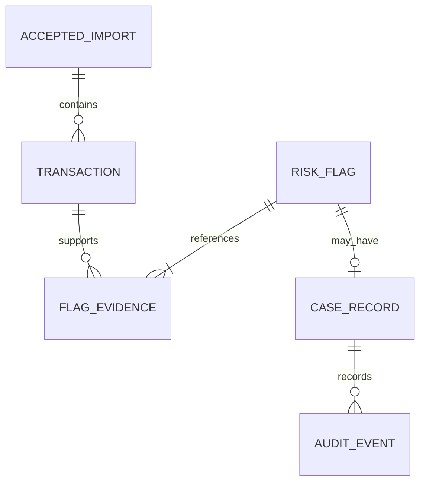

# Data Model

**Project:** AML Transaction Risk Identification System
**Version:** 0.1
**Status:** Approved
**Approval gate:** Review with the API Contract and User Stories before the
Sprint Plan stage
**Review caveats accepted:** API response fields will be reconciled against
this model before endpoint implementation; boundary fixture outcomes remain
pending until rule thresholds/semantics are approved; larger stories will be
subdivided into tasks during Sprint Planning.
**Sources:** Approved BRD, PRD, FRD, NFR, Logical Architecture, Technical
Architecture, and draft `docs/design/design-doc.md`

> This is a proposed logical SQLite model, not an implemented schema. The
> database technology is approved; table details, CSV semantics, driver, and
> migration approach require review. No application schema or source code was
> changed.

## Design principles

- Express is the only application component that reads or writes the single
  SQLite file configured by `AML_DATABASE_PATH`.
- Store only accepted synthetic transaction records. Validate every CSV row
  before writes. Persist an accepted import, its transactions, generated
  flags, and evidence links in one database transaction; rollback on failure.
- Persist flags and evidence and load them on startup. Startup does not
  re-run detection or replace persisted flags.
- Use opaque internal text IDs and SQLite foreign keys. Exact ID generation
  is an implementation choice, not a public contract.
- Represent amounts without binary floating-point as a proposed safeguard;
  exact amount/currency semantics and arithmetic implementation remain open.
- Do not persist uploaded file contents or real customer data. Rejected-import
  records, file metadata, and rejected input retention are not specified.

## Proposed entities and fields

Field names and SQLite types below are proposals for review, not a settled
CSV schema or migration script. Required CSV columns, transaction identity,
timestamp interpretation, amount precision, and currency semantics remain
open.

| Entity/table | Proposed fields | Constraints and purpose |
|---|---|---|
| `accepted_import` | `id TEXT` (PK); `accepted_at TEXT`; `accepted_row_count INTEGER` | One row per accepted submission. Use an application-generated opaque ID. `accepted_at` is a server-generated UTC timestamp proposal. A rejected submission must not create transaction/flag rows; whether to retain rejected-submission metadata is open. |
| `transaction` | `id TEXT` (PK); `import_id TEXT` (FK); `source_transaction_id TEXT` (nullable); `source_timestamp_text TEXT`; `occurred_at TEXT`; `sender_id TEXT`; `receiver_id TEXT`; `amount_decimal TEXT`; `currency TEXT` | One accepted normalized transaction. `occurred_at` is the parsed instant in a proposed normalized representation; parsing/zone rules await the CSV contract. Preserve the original timestamp text for traceability. Do not add a uniqueness constraint to the source ID until duplicate-ID behavior is approved. Amount is stored as a decimal string proposal; currency/scale and numeric semantics remain unresolved. |
| `risk_flag` | `id TEXT` (PK); `category TEXT`; `explanation TEXT`; `generated_at TEXT`; `rule_parameters_json TEXT` (proposed snapshot) | Category is one of rapid fund movement, repeated transfers, circular flows, or structuring-like patterns. Explanation and parameters describe a match; they must not express probability or wrongdoing. The parameter snapshot is proposed to keep persisted results interpretable; exact shape and versioning need review. Do not add a numeric risk score. |
| `flag_evidence` | `flag_id TEXT` (FK); `transaction_id TEXT` (FK); `evidence_order INTEGER` (proposed) | Join table linking each flag to one or more supporting transactions. Composite primary key `(flag_id, transaction_id)` prevents duplicate links. Evidence order is optional presentation metadata, not a rule priority. Foreign-key references must resolve to stored accepted transactions. |
| `case_record` | `id TEXT` (PK); `flag_id TEXT` (FK, UNIQUE); `status TEXT`; `created_at TEXT`; `updated_at TEXT` | At most one case per flag. Status is exactly `Pending`, `Reviewed`, or `Escalated`; new cases start `Pending`. Every transition between distinct statuses is permitted; selecting the current status is a no-op. |
| `audit_event` | `id TEXT` (PK); `case_id TEXT` (FK); `occurred_at TEXT`; `action TEXT`; `actor_label TEXT`; `previous_status TEXT` (nullable); `new_status TEXT` (nullable) | Proposed case-linked audit events. All events have timestamp, action, and actor label; status-change events additionally have previous and new statuses. Both status fields are either present together or absent and, when present, must differ and use an allowed status. Case-creation audit event is optional proposal, not an approved mandatory event; action vocabulary, actor-label source/format, additional event scope, and retention remain open. |

SQLite type mapping (`TEXT`, `INTEGER`) and constraints are proposed. The
technical architecture leaves the SQLite driver open until the Node.js runtime
version is pinned. Exact DDL, indexes, migration tooling, and deletion behavior
are not fixed here.

## Relationships and lifecycle

- An accepted import has zero or more accepted transactions in this proposed
  relationship. Whether an otherwise valid CSV with zero transaction rows is
  accepted remains an explicit CSV-contract decision. A rejected import
  contributes no transaction, flag, or evidence records.
- A flag must link through `flag_evidence` to its supporting transaction
  reference(s); unresolved or dangling evidence is invalid.
- A flag may have no case or one case. The unique `case_record.flag_id`
  enforces at most one case per flag.
- A case lifecycle starts `Pending`; only `Pending`, `Reviewed`, and
  `Escalated` are valid. The API/domain layer enforces the permitted distinct
  transitions and same-status no-op; a no-op creates no status-change event.
- A successful status change and its audit event are written atomically.
  Accepted import data and generated records are also written atomically.
- Deletion/cascade behavior is not prescribed because deletion and retention
  policy remain open.

## Imports, duplicates, and analysis scope

The complete file is parsed and validated before database writes. If any row
or file structure is invalid, reject the whole import, return actionable
errors, and persist none of that submission's transaction or generated
records. For a valid import, commit accepted transactions, generated flags,
and evidence together. Report database failures as failures, never as
successful imports.

Every accepted transaction receives an internal ID. `source_transaction_id`
is a proposed field based on the draft design, but its requiredness,
uniqueness, and duplicate policy are open. This model does not resolve whether
multiple accepted imports are combined or one is selected for analysis or
dashboard summaries. Do not infer a global uniqueness rule or delete/replace
earlier imports.

## Audit and persisted review data

Persist transactions, generated flags, evidence links, cases, and audit
events across restarts. Startup loads saved review data and does not rerun
detection. An explicit future re-analysis operation is outside this stage.
The exact set of actions recorded, actor-label representation, audit
retention, backup, recovery, and deletion remain open. Avoid treating a
failed database write as a completed operation.

## Synthetic fixtures and provenance

Use only synthetic records. Reuse the approved deterministic fixture
`aml-synthetic-demo-v1` from FRD Section 7, with stable synthetic transaction
identifiers and timestamps. It is a test/demo fixture, not a restriction on
other valid synthetic CSVs. Do not add public or customer data. Fixture row
values and rule-boundary outcomes must follow the approved CSV/rule
definitions when those are settled.

## Open decisions retained

- Required/optional CSV columns, encoding/quoting, timestamp and time-zone
  parsing, amount/currency semantics, duplicate-ID behavior, and validation
  details.
- CSV size/row limits and oversized-file behavior.
- Rule thresholds, matching logic, time windows, comparison boundaries,
  parameter snapshot shape, and rule configuration interface.
- Multiple-import dataset/summary behavior.
- Node.js runtime version, SQLite driver, exact schema/migrations, indexes,
  and ID-generation implementation.
- Audit action scope, actor-label value/format, retention, backup, recovery,
  and deletion.
- Performance/resource targets and test coverage/exit criteria.

## Traceability

| Model area | Approved sources |
|---|---|
| Synthetic CSV acceptance and all-or-nothing storage | BRD FR-001–FR-003; PRD Journey A and Import behavior; FRD-001–FRD-004; NFR-003, NFR-007, NFR-014–NFR-015 |
| Transaction and import relationships | BRD FR-001–FR-004; FRD-001–FRD-006; Technical Architecture, “Data persistence and migration approach” |
| Four rule categories, explanations, and evidence | BRD FR-005–FR-009, FR-018; PRD “Risk indicators”; FRD-007–FRD-012; NFR-004, NFR-006, NFR-011–NFR-012 |
| Human-created case and statuses | BRD FR-011–FR-012; PRD Journey C; FRD-013–FRD-014 |
| Audit event shape and atomic change | BRD FR-013; NFR-008; FRD-015; Technical Architecture, “Data persistence and migration approach” |
| Fixture and data safeguards | BRD FR-015–FR-016, NFR-002; PRD Sections 4 and 6; FRD-019; NFR-005, NFR-012 |

## Human approval checklist

- [x] Review proposed entities, fields, SQLite types, and constraints.
- [x] Confirm that CSV field semantics and duplicate behavior remain open.
- [x] Confirm that import and status/audit atomicity match the approved
      Technical Architecture.
- [x] Confirm persisted flags/evidence load on startup without automatic
      re-analysis.
- [x] Confirm one-case-per-flag cardinality and exact case lifecycle.
- [x] Confirm audit actor/action/retention and data deletion details remain
      open where upstream documents leave them unresolved.
- [x] Confirm synthetic-only provenance and requirement traceability.
- [x] Review this model together with the API Contract and User Stories.

**Status:** Approved.
**Reviewer:** Rakesh.
**Decision and date:** Approved as Version 0.1 baseline for the next SDLC stage, 2026-10-20.
**Requested changes:** None. Accepted caveats are recorded above.
