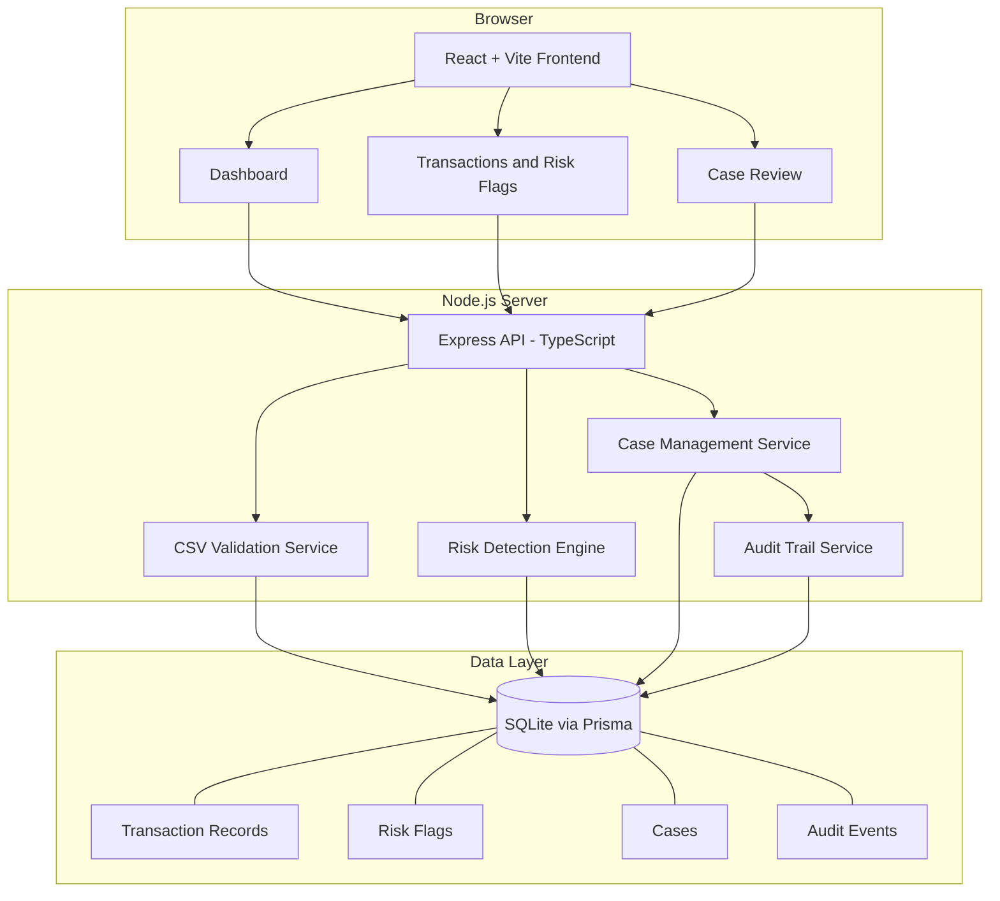
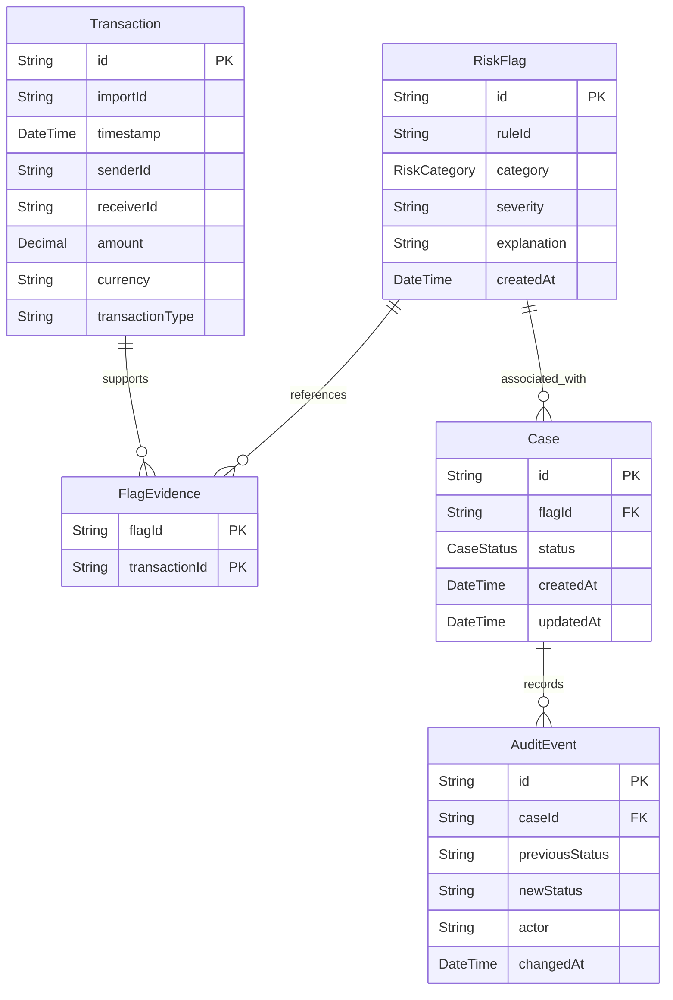
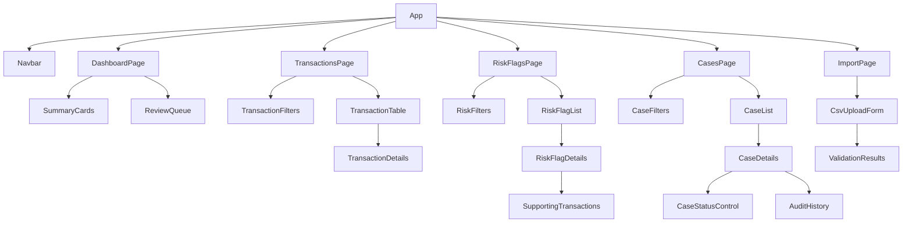
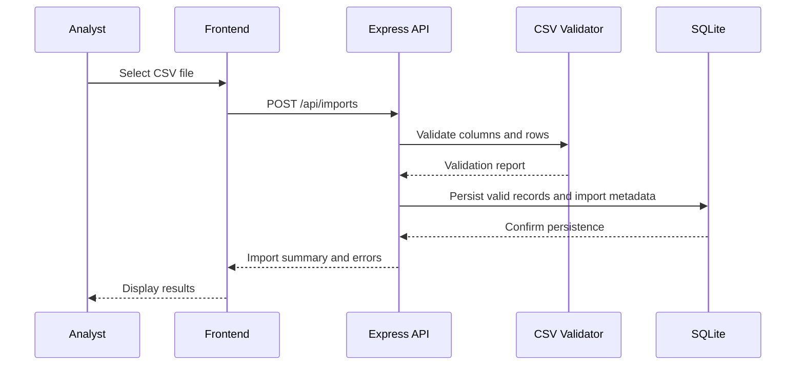
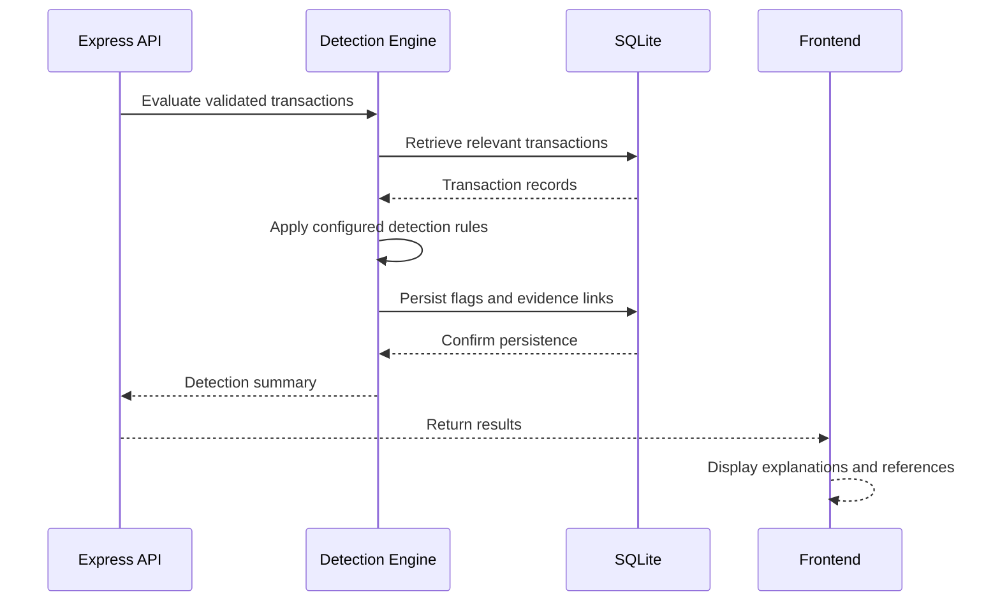
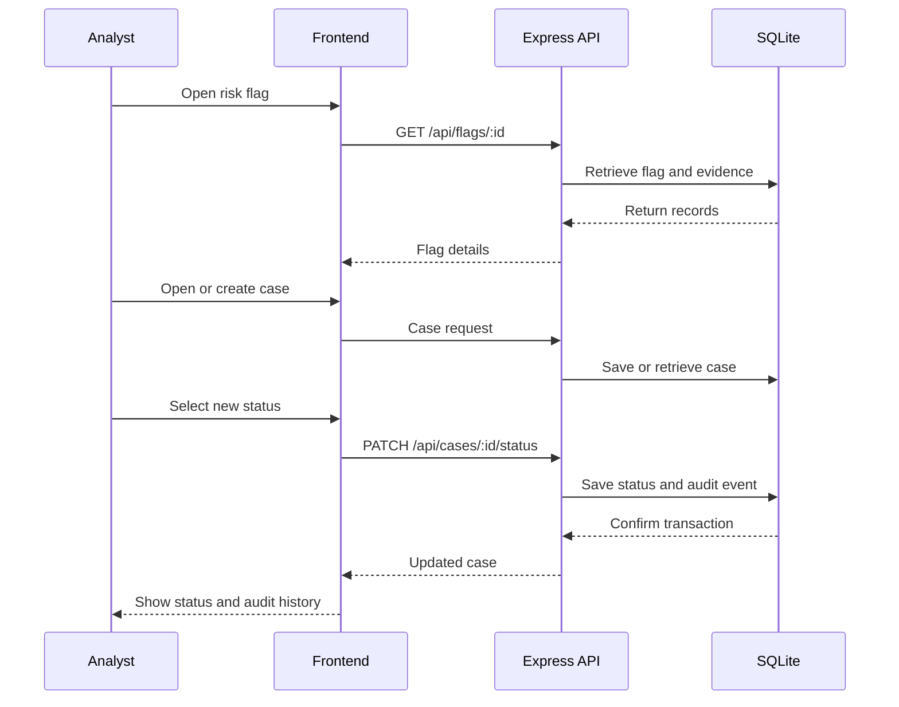

# AML Transaction Risk Identification System — Design Document

**Date:** 2026-10-20

**Source:** BRD.md — AML Transaction Risk Identification System

**Version:** 0.1

**Status:** Draft — pending human review

**Target:** Four-day MVP sprint

**Deployment:** Local development environment

---

## 1. Architecture Overview

The platform is a three-tier web application consisting of a React/Vite frontend, a Node.js/Express/TypeScript backend API, and a local SQLite database. Prisma ORM is proposed for database access, subject to verification against the existing repository.

### 1.1 Architecture diagram



### 1.2 Data flow

- The frontend sends HTTP requests to the backend API.
- The CSV validation service checks uploaded files before records become available for analysis.
- The detection engine evaluates validated transactions against configurable rules.
- Each risk flag contains an explanation, rule identifier, and references to supporting transactions.
- The case management service maintains review status.
- The audit trail records case-status changes and timestamps.
- SQLite persists transactions, flags, cases, and audit events.

### 1.3 Proposed technology stack

| Component               | Technology                                 |
| ----------------------- | ------------------------------------------ |
| Frontend                | React, Vite, TypeScript                    |
| Backend                 | Node.js, Express, TypeScript               |
| Database                | SQLite                                     |
| ORM                     | Prisma                                     |
| Testing                 | Jest or existing repository test framework |
| End-to-end testing      | Playwright, if feasible                    |
| Development environment | VS Code on macOS                           |

**Design boundary:** Risk flags are indicators for human investigation, not proof of money laundering. The system does not make autonomous financial or law-enforcement decisions.

---

## 2. Data Model

### 2.1 Proposed database schema

The following Prisma schema is a starting point for review. It is not yet a verified schema for the existing repository.

```prisma
enum RiskCategory {
  RAPID_MOVEMENT
  REPEATED_TRANSFERS
  CIRCULAR_FLOW
  STRUCTURING_PATTERN
}

enum CaseStatus {
  PENDING
  REVIEWED
  ESCALATED
}

model Transaction {
  id            String       @id
  importId      String
  timestamp     DateTime
  senderId      String
  receiverId    String
  amount        Decimal
  currency      String
  transactionType String?
  createdAt     DateTime     @default(now())

  evidence      FlagEvidence[]

  @@index([importId])
  @@index([timestamp])
  @@index([senderId, receiverId])
}

model RiskFlag {
  id          String        @id
  ruleId      String
  category    RiskCategory
  severity    String
  explanation String
  createdAt   DateTime      @default(now())

  evidence    FlagEvidence[]
  cases       Case[]
}

model FlagEvidence {
  flagId        String
  transactionId String

  flag          RiskFlag   @relation(fields: [flagId], references: [id])
  transaction   Transaction @relation(fields: [transactionId], references: [id])

  @@id([flagId, transactionId])
}

model Case {
  id        String      @id
  flagId    String
  status    CaseStatus  @default(PENDING)
  createdAt DateTime    @default(now())
  updatedAt DateTime    @updatedAt

  flag      RiskFlag    @relation(fields: [flagId], references: [id])
  auditEvents AuditEvent[]
}

model AuditEvent {
  id             String   @id
  caseId         String
  previousStatus String?
  newStatus      String
  actor          String
  changedAt      DateTime @default(now())

  case           Case     @relation(fields: [caseId], references: [id])

  @@index([caseId, changedAt])
}
```

**Implementation notes**

- `Transaction.id` represents the transaction identifier supplied by the input data. Import-batch uniqueness and duplicate handling must be finalized before implementation.
- Monetary precision must be verified against the selected Prisma and SQLite configuration. Do not rely on floating-point arithmetic for financial calculations.
- `FlagEvidence` links each risk flag to its supporting transactions.
- `CaseStatus` restricts statuses to Pending, Reviewed, and Escalated.
- `AuditEvent` records status changes. The application should prevent normal workflows from editing or deleting historical audit events.
- Import metadata, validation errors, and rule configuration may require additional tables or a documented configuration file.

### 2.2 Entity relationship diagram



### 2.3 Design decisions

- Detection is rule-based for the first version.
- Every flag must include a rule identifier and an explanation.
- Evidence references must resolve to stored transactions.
- Cases are associated with flagged activity.
- Case-status updates and audit events should be committed atomically.
- Thresholds and time windows must be configurable.
- Sample data must be synthetic or appropriately licensed public data.
- Risk severity must not be presented as a calibrated probability unless separately validated.

---

## 3. API Endpoints

The following API contracts are proposed from the BRD. They should be finalized before implementation.

### 3.1 Endpoint summary

| Method | Path                     | Description                             | Access           |
| ------ | ------------------------ | --------------------------------------- | ---------------- |
| POST   | `/api/imports`           | Upload and validate a CSV file          | Local MVP access |
| GET    | `/api/transactions`      | List and filter transactions            | Local MVP access |
| GET    | `/api/transactions/:id`  | Retrieve transaction details            | Local MVP access |
| GET    | `/api/dashboard/summary` | Retrieve dashboard counts               | Local MVP access |
| GET    | `/api/flags`             | List and filter risk flags              | Local MVP access |
| GET    | `/api/flags/:id`         | Retrieve flag explanation and evidence  | Local MVP access |
| GET    | `/api/cases`             | List review cases                       | Local MVP access |
| POST   | `/api/cases`             | Create a review case                    | Local MVP access |
| GET    | `/api/cases/:id`         | Retrieve case details and audit history | Local MVP access |
| PATCH  | `/api/cases/:id/status`  | Update case status                      | Local MVP access |

Authentication and authorization are not assumed to exist. Any deployment beyond local use requires appropriate access controls before exposure.

### 3.2 POST `/api/imports`

**Purpose:** Validate and import transaction data from CSV.

Request: `multipart/form-data` containing a `file` field.

Example response — `200 OK`:

```json
{
  "import_id": "imp-001",
  "total_rows": 100,
  "valid_rows": 96,
  "invalid_rows": 4,
  "status": "COMPLETED",
  "errors": [
    {
      "row": 8,
      "field": "amount",
      "message": "Amount must be a valid non-negative number."
    }
  ]
}
```

Expected errors:

- `400` — Invalid file format or missing required columns.
- `413` — File exceeds the configured size limit.
- `500` — Unexpected server-side failure.

The example illustrates the contract; the counts and identifiers must come from actual processing.

### 3.3 GET `/api/flags/:id`

**Purpose:** Retrieve an explainable risk flag and its evidence.

Example response — `200 OK`:

```json
{
  "flag_id": "flag-001",
  "rule_id": "RAPID_MOVEMENT",
  "risk_category": "Rapid movement of funds",
  "severity": "HIGH",
  "explanation": "Funds were transferred onward within the configured time window.",
  "rule_parameters": {
    "window_minutes": 60
  },
  "supporting_transaction_ids": ["txn-101", "txn-102"],
  "review_required": true
}
```

Expected errors:

- `404` — Flag not found.
- `500` — Unexpected retrieval failure.

Severity and thresholds are illustrative and must reflect the actual configured rule.

### 3.4 PATCH `/api/cases/:id/status`

**Purpose:** Change a case's review status and record an audit event.

Request:

```json
{
  "status": "ESCALATED"
}
```

Example response — `200 OK`:

```json
{
  "case_id": "case-001",
  "previous_status": "PENDING",
  "status": "ESCALATED",
  "updated_at": "2026-10-20T12:00:00Z"
}
```

Expected errors:

- `400` — Unsupported status.
- `404` — Case not found.
- `500` — Failed update.

The backend must persist the new status and audit event together. A failed update must not be reported as successful.

### 3.5 Detection logic

The initial detection engine will support four rule categories.

1. **Rapid movement:** Identify qualifying transfers occurring within a configured time window.
2. **Repeated transfers:** Identify repeated transfers between the same counterparties within a configured period.
3. **Circular flows:** Identify transaction paths that return funds to an earlier entity where the available data supports the analysis.
4. **Structuring-like patterns:** Identify activity meeting configured illustrative amount and time-window conditions.

For each rule:

- Read the relevant transaction records.
- Apply the configured conditions.
- Record the rule identifier and explanation when triggered.
- Link the supporting transaction references.
- Make the flag available for human review.

Thresholds are project settings, not universal legal definitions.

---

## 4. Component Structure

### 4.1 Frontend component diagram



### 4.2 Component responsibilities

| Component                | Responsibility                             |
| ------------------------ | ------------------------------------------ |
| `DashboardPage`          | Show transaction, flag, and case summaries |
| `TransactionTable`       | Display imported transactions              |
| `TransactionFilters`     | Filter transactions                        |
| `RiskFlagList`           | List detected patterns                     |
| `RiskFlagDetails`        | Explain a rule trigger                     |
| `SupportingTransactions` | Display linked evidence                    |
| `CaseList`               | List cases and statuses                    |
| `CaseDetails`            | Show case evidence and metadata            |
| `CaseStatusControl`      | Update the review status                   |
| `AuditHistory`           | Display case-status history                |
| `CsvUploadForm`          | Upload transaction files                   |
| `ValidationResults`      | Display import outcomes and errors         |

### 4.3 Suggested frontend services

| File                                 | Responsibilities                           |
| ------------------------------------ | ------------------------------------------ |
| `src/services/importService.ts`      | Upload CSV and retrieve validation results |
| `src/services/transactionService.ts` | Retrieve and filter transactions           |
| `src/services/dashboardService.ts`   | Retrieve dashboard summaries               |
| `src/services/flagService.ts`        | Retrieve flags and supporting evidence     |
| `src/services/caseService.ts`        | Retrieve cases and update status           |

These paths are proposed. Adjust them to match the existing repository rather than creating duplicate structures.

### 4.4 Test selectors

Use stable `data-testid` attributes for critical end-to-end tests.

| Element                 | Suggested selector        |
| ----------------------- | ------------------------- |
| CSV upload form         | `csv-upload-form`         |
| Import submit button    | `csv-import-button`       |
| Validation results      | `validation-results`      |
| Dashboard summary       | `dashboard-summary`       |
| Transaction list        | `transaction-list`        |
| Risk flag list          | `risk-flag-list`          |
| Risk explanation        | `risk-flag-explanation`   |
| Supporting transactions | `supporting-transactions` |
| Case list               | `case-list`               |
| Case status selector    | `case-status-select`      |
| Save status button      | `case-status-save`        |
| Audit history           | `audit-history`           |

---

## 5. Key Flows

### 5.1 CSV import flow



Import behavior for invalid rows and duplicates must be documented. The application must not silently accept malformed records.

### 5.2 Risk detection flow



Detection should run after a successful import in the proposed MVP. Repeated-import behavior and duplicate flag prevention must be defined before implementation.

### 5.3 Case review flow



Case-status changes must be auditable. A flag must not be interpreted as proof of wrongdoing, and any escalation remains a human decision.

---

## 6. Seed Data

All example records below are synthetic and intended for development and repeatable testing.

### 6.1 Transaction seed records

| transaction_id | timestamp            | sender_id | receiver_id | amount | currency |
| -------------- | -------------------- | --------- | ----------- | -----: | -------- |
| txn-001        | 2026-01-10T10:00:00Z | ENT-A     | ENT-B       |    900 | INR      |
| txn-002        | 2026-01-10T10:20:00Z | ENT-B     | ENT-C       |    850 | INR      |
| txn-003        | 2026-01-10T11:00:00Z | ENT-D     | ENT-E       |    250 | INR      |
| txn-004        | 2026-01-10T11:15:00Z | ENT-D     | ENT-E       |    250 | INR      |
| txn-005        | 2026-01-10T12:00:00Z | ENT-F     | ENT-G       |    400 | INR      |
| txn-006        | 2026-01-10T12:30:00Z | ENT-G     | ENT-H       |    390 | INR      |
| txn-007        | 2026-01-10T13:00:00Z | ENT-H     | ENT-F       |    380 | INR      |

These records illustrate rapid movement, repeated transfers, and a potential circular flow. They are not a validated AML dataset. Exact expected detections depend on the configured rules and should be documented in tests.

### 6.2 Expected synthetic scenarios

| Scenario           | Expected evaluation                                                                                            |
| ------------------ | -------------------------------------------------------------------------------------------------------------- |
| Rapid movement     | `txn-001` and `txn-002` should qualify if the rule's conditions are satisfied                                  |
| Repeated transfers | `txn-003` and `txn-004` should qualify under the configured repetition rule                                    |
| Circular flow      | `txn-005`, `txn-006`, and `txn-007` form a synthetic cycle                                                     |
| Benign lookalike   | Additional test data should include repeated or rapid transactions that should not trigger the applicable rule |
| Invalid input      | A record with an invalid amount or timestamp should produce a validation error                                 |

The synthetic scenario set must be expanded to cover positive, negative, and threshold-boundary tests before the MVP is accepted.

### 6.3 Case seed records

| case_id  | flag_id  | status    |
| -------- | -------- | --------- |
| case-001 | flag-001 | PENDING   |
| case-002 | flag-002 | REVIEWED  |
| case-003 | flag-003 | ESCALATED |

These are illustrative fixtures. Their corresponding flags and audit events must exist if these cases are loaded into the database.

---

## 7. FR Traceability

| BRD requirement                   | Data model / service                     | API endpoint                              | UI component                    |
| --------------------------------- | ---------------------------------------- | ----------------------------------------- | ------------------------------- |
| FR-001: CSV import                | Transaction, import handling             | `POST /api/imports`                       | `CsvUploadForm`                 |
| FR-002: Validate records          | CSV validation service                   | `POST /api/imports`                       | `ValidationResults`             |
| FR-003: Report invalid rows       | Import validation results                | `POST /api/imports`                       | `ValidationResults`             |
| FR-004: Transaction summaries     | Transaction records and summary service  | `GET /api/dashboard/summary`              | `SummaryCards`                  |
| FR-005: Rapid movement            | Detection engine                         | Import-triggered evaluation               | `RiskFlagList`                  |
| FR-006: Repeated transfers        | Detection engine                         | Import-triggered evaluation               | `RiskFlagList`                  |
| FR-007: Circular flows            | Detection engine                         | Import-triggered evaluation               | `RiskFlagList`                  |
| FR-008: Structuring-like patterns | Configurable detection rules             | Import-triggered evaluation               | `RiskFlagList`                  |
| FR-009: Explanations and evidence | `RiskFlag`, `FlagEvidence`               | `GET /api/flags/:id`                      | `RiskFlagDetails`               |
| FR-010: Filters                   | Transaction and flag query services      | `GET /api/transactions`, `GET /api/flags` | Filter components               |
| FR-011: Case creation             | `Case`                                   | `POST /api/cases`                         | `CaseList`                      |
| FR-012: Case statuses             | `CaseStatus`                             | `PATCH /api/cases/:id/status`             | `CaseStatusControl`             |
| FR-013: Audit trail               | `AuditEvent`                             | `GET /api/cases/:id`                      | `AuditHistory`                  |
| FR-014: Dashboard counts          | Summary service                          | `GET /api/dashboard/summary`              | `DashboardPage`                 |
| FR-015: Synthetic scenarios       | Seed fixtures and scenario files         | Not applicable                            | Demonstration workflow          |
| FR-016: Automated tests           | Unit, integration, and end-to-end suites | All relevant routes                       | Critical UI workflows           |
| FR-017: Local setup               | Repository documentation                 | Not applicable                            | Not applicable                  |
| FR-018: Configurable thresholds   | Rule configuration                       | Configuration-dependent                   | Configuration interface or file |

---

## Design Review Checklist

Before implementation, verify the following:

- [ ] The architecture matches the existing repository.
- [ ] The CSV schema and duplicate-import policy are agreed.
- [ ] The database schema is reviewed and migration strategy is defined.
- [ ] Detection rules have explicit conditions and configurable thresholds.
- [ ] API request and response contracts are approved.
- [ ] Synthetic test scenarios have documented expected outcomes.
- [ ] Case-status changes and audit events are persisted consistently.
- [ ] Security and privacy assumptions are documented.
- [ ] FR traceability is maintained through user stories and tests.
- [ ] A human reviews the design before development proceeds.

**End of document.**
